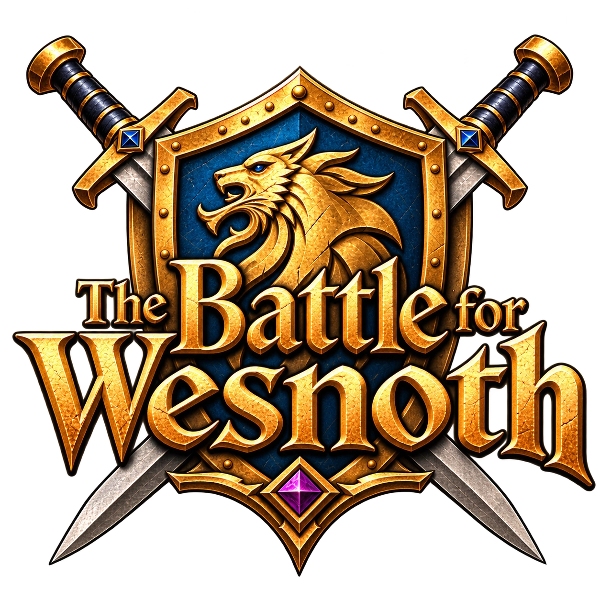
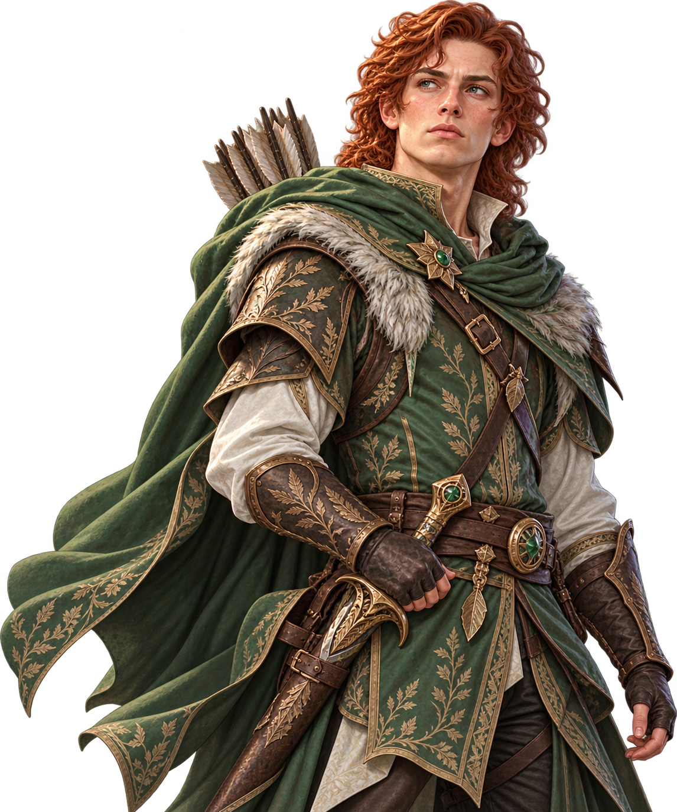
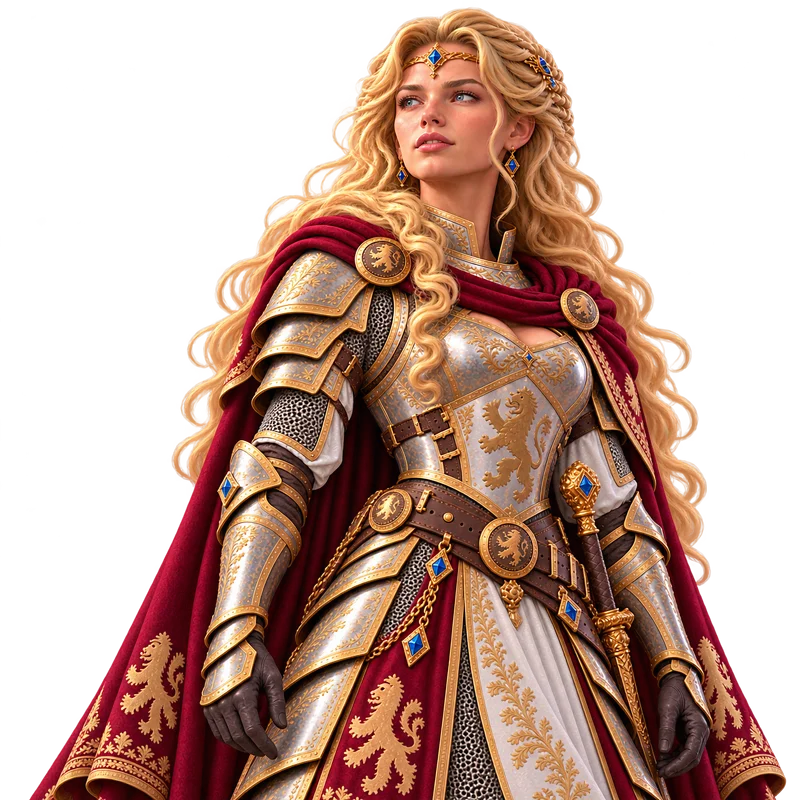
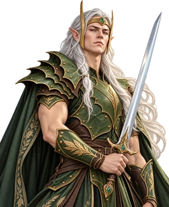
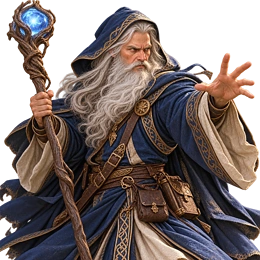
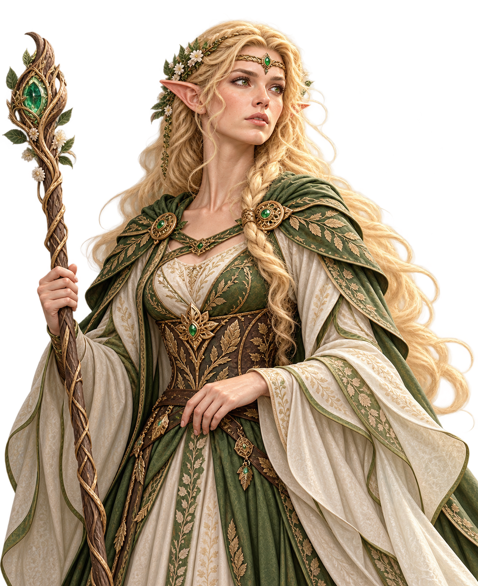
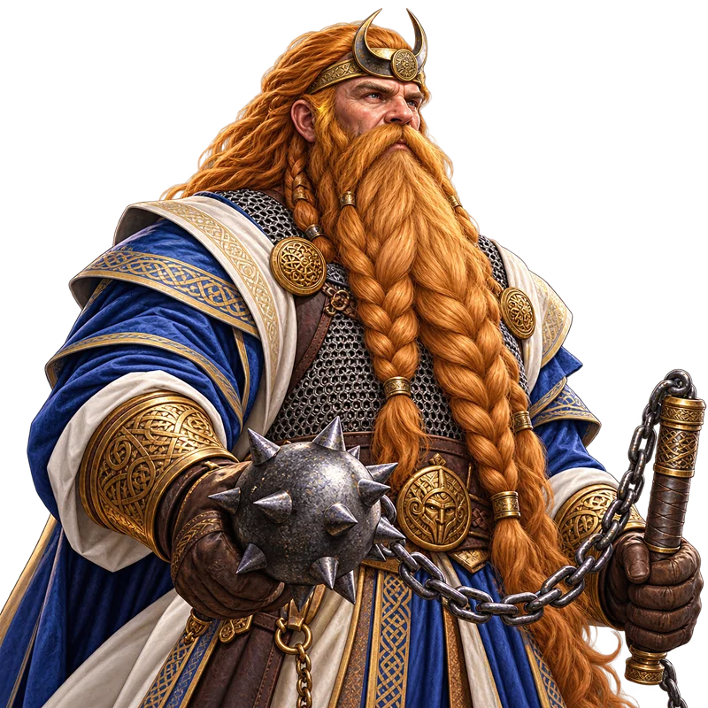

<p align="center">
  
</p>

# WESNOTH MOBILE

**A mobile-first Android adaptation of [The Battle for Wesnoth](https://www.wesnoth.org/).**

[](https://github.com/purdygeorgeedward-dev/Wesnoth-Mobile/tree/master)
[](packaging/android)
[](COPYING)

**Wesnoth Mobile** aims to bring the depth of Wesnoth's turn-based fantasy strategy to modern Android phones **without treating a phone like a miniature desktop**. The project builds on Wesnoth's existing game engine and content while developing a touch-oriented, responsive interface designed for portrait and landscape play.

> **Development status:** This fork is a work in progress. The Android foundation has been modified, but the planned native interface redesign is not complete. No APK from the current source changes has yet been built and verified. Features described as *planned* below are not promises of current functionality.

## The Game

<p align="center"></p>

[The Battle for Wesnoth](https://www.wesnoth.org/) is a free and open-source, turn-based tactical strategy game set in a richly developed fantasy world. Recruit armies, capture villages, manage gold and terrain advantages, advance veteran units, and fight through story-driven campaigns. The upstream game includes single-player adventures, multiplayer modes, user-created content, and extensive modding capabilities.

Wesnoth Mobile intends to preserve that strategic experience while making it comfortable to play on a touchscreen.

## The Legends of Wesnoth

Wesnoth's story-driven campaigns span centuries of fantasy history, from the founding of the kingdom to the distant future. Here are some of its best-known adventures and characters.

### Heir to the Throne

One of Wesnoth's most recognizable campaigns, *Heir to the Throne* follows **Konrad**, a young man raised among the elves, as he challenges **Queen Asheviere**'s rule. Guided by the legendary mage **Delfador**, he searches for the **Sceptre of Fire** and gathers allies, including **Princess Li'sar** and the ancient elvish lord **Kalenz**. Questions of loyalty, identity, and rightful rule drive the adventure.

### The Rise of Wesnoth

*The Rise of Wesnoth* tells the story of **Prince Haldric**, who leads refugees from the Green Isle across the ocean and struggles to establish a new homeland. Alongside **Lady Jessene**, he faces dangers that include the formidable **Lich-Lord Jevyan**. This campaign explores the origins of the kingdom featured in later stories.

### Legend of Wesmere

Set in an earlier age, *Legend of Wesmere* follows **Kalenz** through wars and political struggles that shape elvish history. It reveals the experiences behind the legendary leader encountered in *Heir to the Throne*.

### Delfador's Memoirs

Long before mentoring Konrad, **Delfador** was a young mage caught up in events that would change Wesnoth. *Delfador's Memoirs* follows his early adventures and the path toward his reputation as one of the kingdom's greatest wizards.

### Northern Rebirth

In the Northlands, **Tallin** helps lead a rebellion against orcish domination. *Northern Rebirth* brings humans, dwarves, and other peoples together in a hard-fought struggle for freedom and a new political order.

### Under the Burning Suns

Set in Wesnoth's distant future, *Under the Burning Suns* follows the desert elf **Kaleh**, alongside **Nym**, as their people search for a new home in a drastically changed world. Its setting and survival-focused journey offer a striking contrast to the kingdom's earlier adventures.

### Bringing the Characters to Life

The personalities of Wesnoth's heroes and villains are as important to its storytelling as its battles. Character portraits communicate courage, uncertainty, anger, wisdom, and defeat before a line of dialogue is spoken.

Under the direction of George Edward Purdy, the lead artist and character designer from Master of Magic, this project's graphics work revisits familiar characters with new portraits, expressions, costumes, and interpretations, while drawing inspiration from the world and stories that made them memorable. 

(These illustrations are part of an evolving presentation effort, not a claim that every campaign has already been redesigned.)

For more about the original adventures, see the [Wesnoth campaign documentation](https://wiki.wesnoth.org/Mainline_campaigns).

## Our Direction

<p align="center"></p>

Wesnoth Mobile is being designed around a phone-first experience: an independent Android app with a responsive launcher, portrait and landscape support, intuitive touch controls, and menus, dialogs, and battlefield controls adapted to small screens. The longer-term vision includes a distinctive startup experience, interface styling, and original visual and musical assets.

The guiding principle is straightforward: **keep the strategy; rethink the interaction.**

## Development Progress

<p align="center"></p>

Development takes place directly on [`master`](https://github.com/purdygeorgeedward-dev/Wesnoth-Mobile/tree/master). The upstream gameplay and content remain the starting point.

The first source changes establish a separate Android application ID, improve launcher sizing and accessibility, remove forced orientation restrictions, correct launch argument formatting, address first-run status-file initialization, and improve ZIP archive extraction safety. These changes still require compilation and device testing.

The Android source changes have not yet been compiled or tested on a device.

### Follow the Work

- [Developer log](DEVELOPER_LOG.md) — ongoing engineering decisions, progress, and risks.
- [Development change log](MOBILE_DEVELOPMENT_LOG.md) — detailed changes and validation requirements.
- [Build notes](BUILD_NOTES.md) — build-by-build results and device observations once APKs are published.
- [GitHub commits](https://github.com/purdygeorgeedward-dev/Wesnoth-Mobile/commits/master) — the source history.

## Building from Source

<p align="center"></p>

This repository contains Wesnoth's upstream C++ game engine and an Android packaging project under [`packaging/android/`](packaging/android/). Native dependencies, Android SDK/NDK tooling, and source submodules are required.

For the general engine requirements, see [INSTALL.md](INSTALL.md). Clone with submodules:

```bash
git clone --recurse-submodules https://github.com/purdygeorgeedward-dev/Wesnoth-Mobile.git
cd Wesnoth-Mobile
```

The Android Gradle project is in `packaging/android`. For the full dependency → C++ engine → APK/AAB procedure, including GitHub Actions and local Linux commands, see the [Android Build Guide](docs/ANDROID_BUILD_GUIDE.md). The instructions are source-verified but a successful fork build and device test have not yet been recorded. Check [BUILD_NOTES.md](BUILD_NOTES.md) for actual build results.

## Upstream and Community

<p align="center"></p>

Wesnoth Mobile is an **independent fork**, not an official release of The Battle for Wesnoth. The original project and its contributors created the game on which this work depends.

For upstream gameplay documentation, campaigns, community content, and support:

- [Official Wesnoth website](https://www.wesnoth.org/)
- [Wesnoth wiki](https://wiki.wesnoth.org/)
- [Official forums](https://forums.wesnoth.org/)
- [Upstream source repository](https://github.com/wesnoth/wesnoth)
- [Wesnoth manual](https://wiki.wesnoth.org/WesnothManual)

## Licensing and Attribution

<p align="center"></p>

Wesnoth is free and open-source software. The game's source code is licensed under the **GNU General Public License, version 2 or later**; see [COPYING](COPYING). Artwork, music, and other content may have different applicable licenses and attribution requirements. See the upstream [copyright and licensing information](https://wiki.wesnoth.org/Wesnoth:Copyrights) and individual file notices.

This fork retains the obligations and notices of the upstream project. New mobile-specific work must comply with the applicable licenses.

---

*Wesnoth Mobile — a familiar world, redesigned for your fingertips.*

